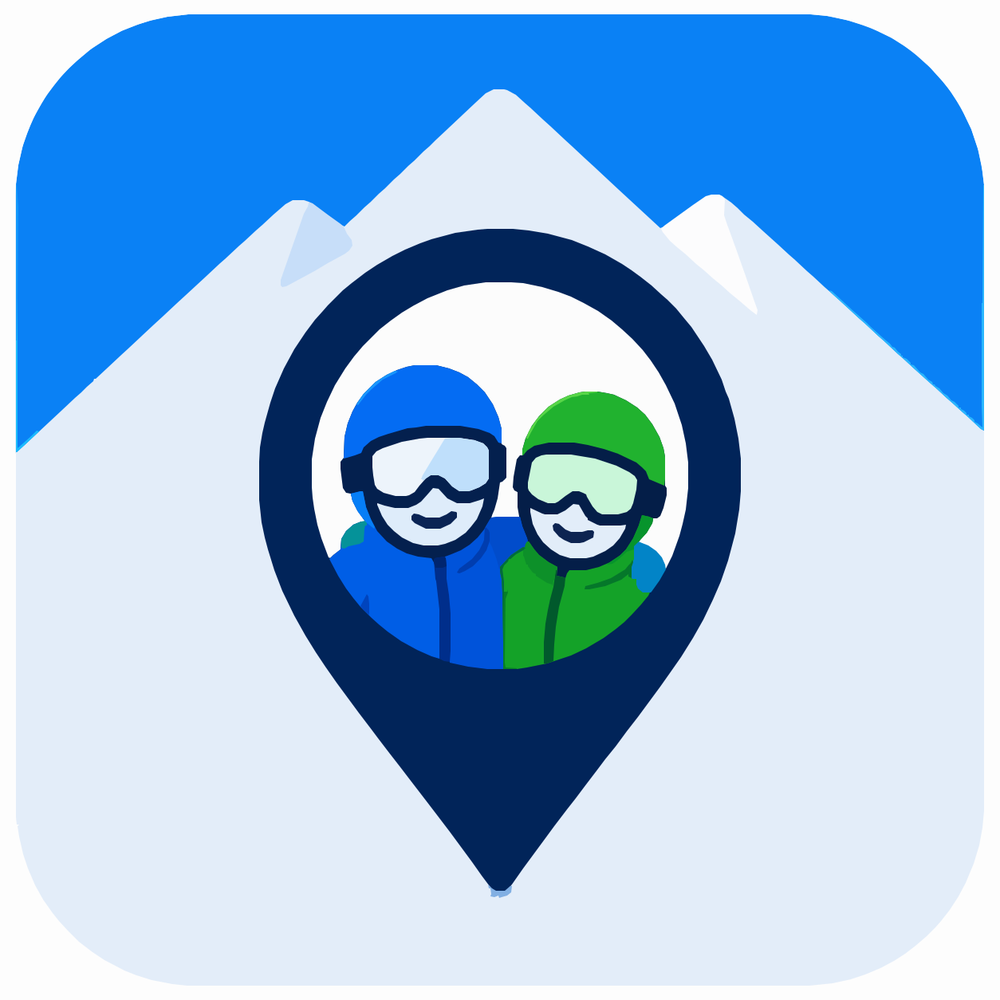

{: .panel__icon}

Snowmigos
{: .panel__title}

Thanks for testing. It shows you which run or lift everyone in your group is on, so pick the
phone you ski with — that is the one we need the app on.
{: .panel__lede}

<section class="beta__platform" id="beta-ios" markdown="1">

### iPhone


Install **TestFlight** from the App Store first, then open the invite:

<a class="btn btn--primary btn--large" href="{{ page.testflight_url }}">Get the beta on TestFlight</a>

You will need an Apple Account, which you already have if you use the App Store. Nothing is
added to any account of ours, and you can leave at any time from inside TestFlight.
{: .beta__note}

Not open yet — the TestFlight link lands here as soon as Apple has looked at the first build.
{: .beta__note}


</section>

<section class="beta__platform" id="beta-android" markdown="1">

### Android


Two steps, and both need the **same Google account your phone uses for the Play Store**.

1. [Join the testers group]({{ page.android_group_url }}) — this is what lets Google give you
   the app.
2. [Open the beta on Google Play]({{ page.android_opt_in_url }}) and tap **Become a tester**,
   then install.

If Play says the app is not available, you are almost certainly signed in with a different
account from the one that joined the group.
{: .beta__note}

Not open yet — the Google Play links land here shortly.
{: .beta__note}


</section>

Found something odd, or the battery vanished? Tell us what you were doing at the time:
[support@kuamka.com](mailto:support@kuamka.com). Rough notes are genuinely useful — "lift
said skiing for a couple of minutes near the top of Signal" is plenty.
{: .beta__ask}

Share this page: **snowmigos.com/beta**
{: .beta__share}

[What the app does with your location](/privacy/)
{: .panel__footnote}

