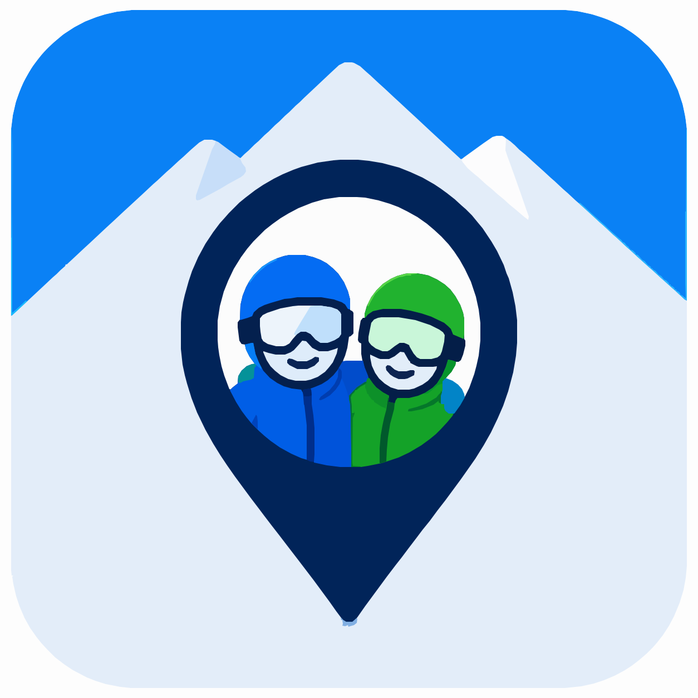

{: .panel__icon}

A friend invited you to see each other on the mountain. Get the app, then tap the link again to join the trip.

Snowmigos is coming to the App Store and Google Play

<a href="#" id="sm-open" hidden>Already have the app? Open it</a>

[What the app does with your location](/privacy/)
{: .panel__footnote}

